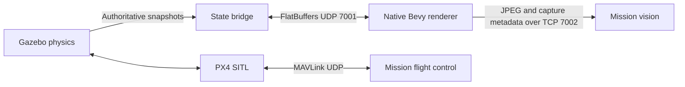

# Architecture

The Docker backend contains PX4 binaries, Gazebo libraries, vehicle physics and
sensor SDF definitions, one collision-only world, plugins, and the bridge.
Unrelated models/worlds and all visual geometry are removed during export.
The native bundle contains the executable, visual
assets, and the SUAS scenario. Runtime Docker startup passes scalar settings as
environment variables and publishes ports; no source checkout is mounted.

The launcher loads the SUAS scenario, resolves its origin and camera settings,
ensures a backend image exists, creates a labeled container, waits for a real
health check, and opens Bevy. It owns the new container by ID and removes that
container on renderer exit or an orderly interrupt. An independent `start`
command deliberately transfers lifecycle responsibility to `stop`.

The state protocol and camera protocol have different responsibilities. UDP
snapshots let Bevy apply the newest valid state without waiting for retransmits.
Camera images retain the existing JPEG/TCP contract with simulation identity,
time, and intrinsics. Replacing camera transport in a later release requires a
decision about how vision receives that metadata; ordinary video alone does
not carry the existing application-level fields automatically.

The visual world remains independent from the current physics world. Adding
terrain-dependent sensor behavior or collisions requires matching geometry in
the backend. A visible object is not automatically a physical obstacle.
